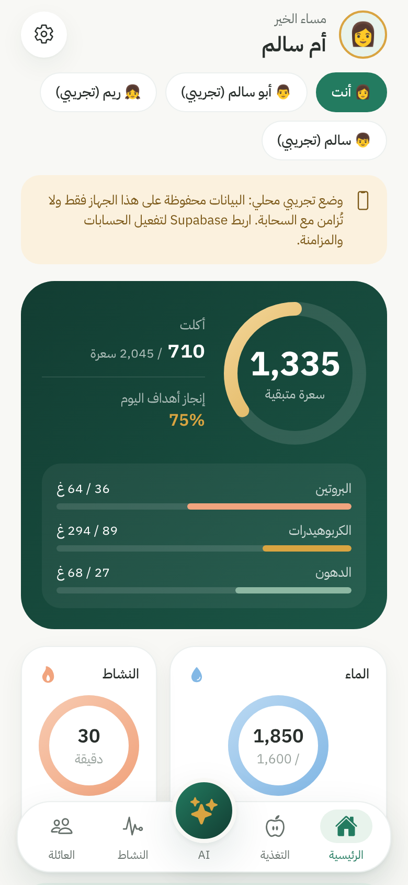
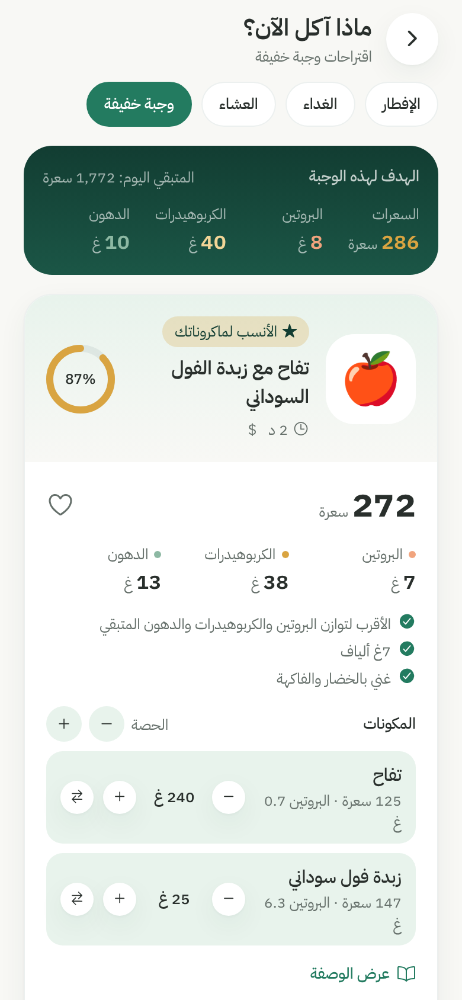
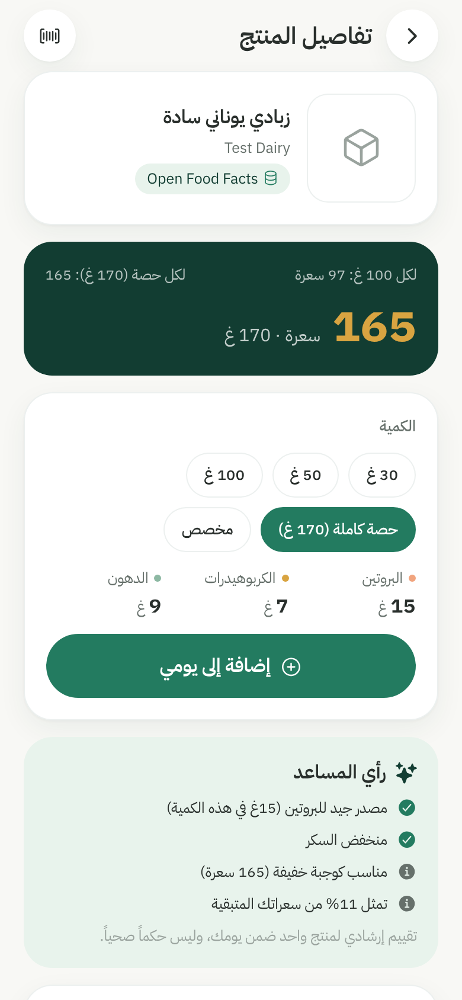
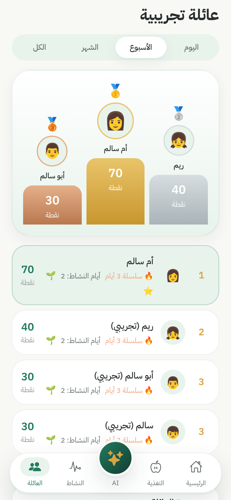
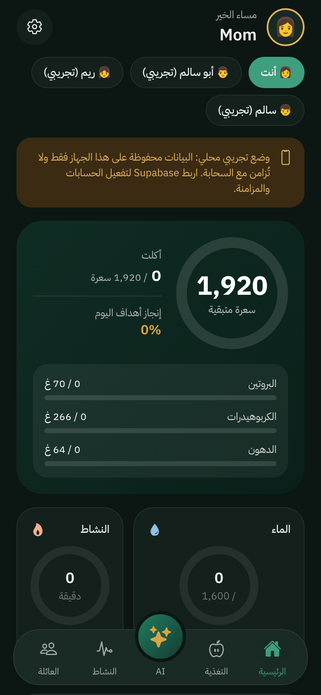

# FamilyFit AI

**معاً لحياة أكثر صحة وسعادة** — مساعد صحي عائلي: تغذية ذكية، ماء، نشاط، ومنافسة عائلية قائمة على العادات.

Expo (React Native, iOS / Android / Web) · TypeScript · Supabase (Postgres + Auth + RLS) · Open Food Facts.

| | | |
|---|---|---|
|  |  |  |
|  |  |  |

## ما الذي يعمل الآن (المراحل 1–3 + الميزات ذات الأولوية)

- **الهوية والتصميم:** Premium HealthTech (الأخضر الغابي، الذهبي، الأزرق المائي، المرجاني)، خط IBM Plex Sans Arabic، العربية افتراضياً مع RTL كامل (الحلقات والأشرطة والتنقل)، الإنجليزية LTR، الوضع الداكن، Bottom Sheets، Skeleton loading، حركات دقيقة، Haptics.
- **الحسابات والعائلة:** تسجيل بالبريد، إنشاء عائلة أو الانضمام برمز دعوة، مدير العائلة، أفراد بإشراف ولي الأمر (مع تسجيل الموافقة)، تبديل عرض بيانات الطفل.
- **الملف الصحي والأهداف:** Mifflin-St Jeor للبالغين، معادلة IOM للأطفال 3–18، مرجع عمري عند غياب الوزن، **بلا أي عجز حراري للقُصّر**، حد أدنى آمن للبالغين، أهداف قابلة للتخصيص.
- **محرك التغذية وسجل الوجبات:** 8 عناصر غذائية، بيانات من USDA FoodData Central، تحديث فوري للمتبقي، منع الاحتساب المزدوج (`dedupe_key` فريد).
- **ماذا آكل الآن؟** ثلاثة اقتراحات (الأنسب للماكرونات / صحي ومتنوع / سريع واقتصادي) من 24 وصفة. يوازن البروتين والكربوهيدرات والدهون، يحترم الحساسية والتفضيلات والأطعمة غير المرغوبة (مع استبدال تلقائي)، يتعلم من المفضلة والمرفوض والوجبات الأخيرة، ولا يدفع المستخدم لاستهلاك كل المتبقي. تعديل الكمية واستبدال المكون يعيدان الحساب فوراً.
- **ماسح الباركود:** EAN-13 / EAN-8 / UPC-A / UPC-E / QR (GS1 Digital Link) عبر `expo-camera`، بحث في Open Food Facts، بطاقة منتج كاملة، تقييم إرشادي غير قطعي، كميات 30/50/100/حصة/مخصص، وإدخال يدوي يُحفظ في قاعدة بيانات العائلة عند عدم وجود المنتج.
- **المنافسة العائلية:** نقاط للعادات فقط (الماء، الوجبات، النشاط، الخطوات)، يتحقق منها الخادم ولا تُمنح إلا مرة يومياً، لوحة متصدرين (يوم/أسبوع/شهر/الكل) مع منصة تتويج وسلاسل أيام وشارات، وقواعد نقاط يعدّلها المدير.
- **الماء والنشاط:** أزرار 150/250/350/500/مخصص، تسجيل نشاط يدوي مع تقدير سعرات قائم على MET (يظهر كتقدير، ولا يُحسب دون وزن).

### الميزات المتقدمة

- **الصيام الذكي:** زر "أنا صائم اليوم" في الرئيسية والملف الشخصي، إعدادات الصيام (3 أيام من كل شهر، الاثنين والخميس، الأيام البيض، رمضان، تطوعي، مخصص)، تقويم هجري (أم القرى) وميلادي يعرض المكتمل والمخطط والمتبقي ومجموع الشهر، تعديل التقويم الهجري ±2 يوم مع تنبيه اختلاف بداية الشهر، وسجل الصيام.
- **شارات الصيام:** شارة "إنجاز صيام ثلاثة أيام من كل شهر" (هلال وثلاث نجوم، ذهبي وأخضر داكن) تظهر في الملف الشخصي، وشارات أول صيام و6 أيام و10 أيام والتحدي الشهري والاستمرارية. اليوم المخطط لا يُحتسب، ويجب أن يؤكد المستخدم إتمام اليوم؛ والشارات تُمنح في الخادم فقط. تحدي العائلة اختياري ويعرض المجموع فقط بلا ترتيب.
- **وضع تغذية الصيام:** يوزّع الهدف اليومي نفسه على الإفطار ووجبة خفيفة والسحور دون أي تقليل أو عجز، مع التركيز على البروتين والألياف والماء. تنبيهات للحمل والرضاعة والسكري والأدوية والأمراض المزمنة، ولا يُفعَّل للأطفال إلا بموافقة ولي الأمر.
- **حلل وصفة من فيديو:** رابط (Instagram وTikTok وYouTube وShorts وFacebook وPinterest)، رفع فيديو أو تسجيل شاشة (لقطات تُستخرج على الجهاز)، نص الوصفة أو وصف الفيديو، صور المكونات، أو إدخال يدوي. نقرأ المحتوى العام المتاح قانونياً فقط، ولا ننزّل الفيديوهات. الكميات غير الواضحة تُعلَّم للمراجعة ولا تُخترع.
- **القيم الغذائية للوصفة:** للوصفة كاملة وللحصة ولكل 100 غ (عند إدخال الوزن النهائي)، 8 عناصر من بيانات USDA، مع درجة دقة وقائمة بما لم يُحسب، وتقدير معلن لزيت القلي الممتص.
- **بدائل صحية:** بطاقة لكل بديل (الأصلي، البديل، السبب، القيم قبل وبعد، التأثير على الطعم والقوام) دون افتراض أن الأقل سعرات أفضل، ثم "طبق البديل على الوصفة" لإنشاء نسخة محسّنة ومقارنتها بالأصلية.
- **مطابقة الوصفة لما تبقى:** نسبة التوافق، ما تضيفه الحصة وما يتبقى بعدها، ثم "أضف هذه الوصفة إلى خطتي الغذائية" بعد اختيار الكمية والتأكيد.
- **مكتبتي المفضلة:** وصفات مفضلة في 12 مجلداً مع ملاحظات، وصفاتي، وصفات العائلة المشتركة (تقييم وتعليقات وحفظ)، ووصفات FamilyFit، ومكونات مفضلة لكل فرد، وخيار "اقترح من مفضلتي أولاً" في اقتراح الوجبة التالية (دون مسببات الحساسية ومع تجنب التكرار).
- **ملف الوصفة:** معاينة ثم PDF وواتساب والبريد والطباعة والحفظ على الهاتف وفي المكتبة؛ قائمة مكونات قابلة للتأشير، خطوات مرقمة، وجدول قيم غذائية.
- **الترجمة:** العربية والإنجليزية والفلبينية والهندية والأردية والنيبالية والفرنسية، مع زر بارز "ترجم الوصفة إلى الفلبينية" بلغة بسيطة لمساعدة المنزل. الكميات والوحدات والأوقات ثابتة لا تُترجم، ويُفحص كل رقم في الخطوات المترجمة. وصفات FamilyFit مترجمة مسبقاً للفلبينية، وتعديل الترجمة وحفظها متاح.

## ما يحتاج مفاتيحك أو حساباتك (غير مفعّل وموضح في الواجهة)

| الخدمة | الحالة | ما المطلوب |
|---|---|---|
| Supabase | بدونها يعمل التطبيق في **وضع تجريبي محلي** مع شريط واضح | مشروع Supabase + `EXPO_PUBLIC_SUPABASE_URL` و`EXPO_PUBLIC_SUPABASE_ANON_KEY` |
| الدخول برقم الجوال | الزر معطّل | مزوّد SMS (مثل Twilio) في Supabase، ثم `EXPO_PUBLIC_AUTH_PHONE=true` |
| Apple Sign In | الزر معطّل | حساب Apple Developer + مزوّد Apple في Supabase، ثم `EXPO_PUBLIC_AUTH_APPLE=true` |
| Google Sign In | الزر معطّل | Google OAuth client + مزوّد Google في Supabase، ثم `EXPO_PUBLIC_AUTH_GOOGLE=true` |
| تحليل صور الطعام / OCR / المساعد الصحي | معلّمة "المرحلة 4/8" وغير قابلة للضغط | مفتاح خدمة رؤية/LLM يوضع في أسرار Edge Functions (وليس في التطبيق) |
| تحليل الفيديو والصور وترجمة وصفاتك الخاصة | الخيارات توضّح أنها تحتاج الخدمة؛ النص والإدخال اليدوي يعملان دائماً | Supabase + `supabase secrets set ANTHROPIC_API_KEY=...` ثم `EXPO_PUBLIC_AI_FUNCTIONS=true` (المفتاح في أسرار الخادم فقط) |
| روابط Instagram وFacebook | رسالة واضحة باقتراح البدائل | رمز تطبيق Meta للـ oEmbed: `supabase secrets set META_OEMBED_TOKEN=...` |
| تحويل الكلام في الفيديو إلى نص | غير متاح، ونعتمد على النص الظاهر والوصف | خدمة تفريغ صوتي (غير مربوطة) |
| Apple Health / Health Connect | الخطوات تُدخل يدوياً مع توضيح | بناء تطوير (development build) + الصلاحيات، المرحلة 6 |

## التشغيل

```bash
npm install
cp .env.example .env        # اتركه فارغاً لتجربة الوضع المحلي
npx expo start              # iOS / Android عبر Expo Go أو development build
npx expo start --web        # الويب (المسح بالكاميرا متاح على الهاتف فقط)
```

### ربط Supabase

```bash
supabase link --project-ref <ref>
supabase db push                       # supabase/migrations
psql "$DATABASE_URL" -f supabase/seed.sql   # الأطعمة والوصفات
supabase functions deploy delete-account analyze-recipe translate-recipe
supabase secrets set ANTHROPIC_API_KEY=sk-...   # اختياري: تحليل الفيديو والترجمة
```

## الاختبارات

```bash
npm test                     # 59 اختباراً: السعرات، الوجبة التالية، Open Food Facts، النقاط، الوصفات، البدائل، الهجري، الصيام، الترجمة
npm run typecheck
PGHOST=... PGPORT=... PGUSER=postgres supabase/tests/run.sh   # الهجرة + اختبارات عزل RLS على Postgres
npm run seed                 # يعيد توليد supabase/seed.sql من src/data
```

اختبارات RLS تتحقق من: عزل العائلات تماماً، عدم رؤية البالغ لبيانات بالغ آخر الصحية، رؤية المدير لملفات الأطفال، منع كتابة النقاط مباشرة، النقاط مرة واحدة يومياً، ورفض تسجيل الوجبة نفسها مرتين. واختبارات الصيام والوصفات (28 فحصاً) تتحقق من: عدم احتساب الأيام المخططة، رفض إتمام يوم مستقبلي، منح الشارة مرة واحدة من الخادم، منع صيام الطفل دون موافقة ولي الأمر، خصوصية الوصفات والمفضلة، وحساب القيم في قاعدة البيانات.

## البنية

```
src/app/            الشاشات (Expo Router)
src/lib/            nutrition.ts · nextMeal.ts · openFoodFacts.ts · points.ts · recipe.ts · recipeParser.ts · substitutions.ts · recipeDoc.ts · hijri.ts · fasting.ts  (منطق نقي ومختبَر)
src/data/           foods.ts (USDA) · recipes.ts · recipeLexicon.ts · recipeI18n.ts (الفلبينية)
src/backend/        supabase.ts · local.ts  (نفس الواجهة)
src/components/     نظام التصميم الموحد
supabase/           migrations · seed.sql · tests · functions
```

## المراحل القادمة

4) تحليل صور الطعام وOCR للملصق · 5) مخطط الوجبات الأسبوعي وقائمة المشتريات ومساعد الثلاجة · 6) النوم وربط Apple Health / Health Connect · 7) التحديات ومتجر المكافآت · 8) المساعد الصحي والتقارير وPDF والإشعارات · 9) اختبار شامل وتحسين الأداء والأمان.

> FamilyFit AI لا يقدّم تشخيصاً طبياً ولا يصف أدوية ولا يغني عن الطبيب.
